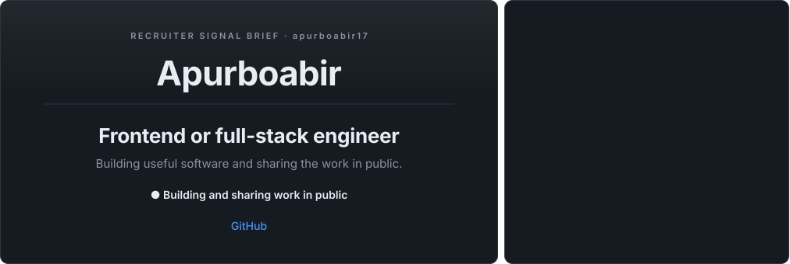

<picture>
  <source media="(prefers-color-scheme: light)" srcset="https://raw.githubusercontent.com/ApurboAbir17/ApurboAbir17/main/assets/hero-light.svg" />
  
</picture>

<h2>What teams can evaluate quickly</h2>

<table width="100%">
<tr>
<td width="33%" valign="top"><h3>Role fit</h3>
Frontend or full-stack engineer · JavaScript · CSS · HTML
</td>
<td width="33%" valign="top"><h3>Public proof</h3>
4 repositories · 0 stars
</td>
<td width="33%" valign="top"><h3>Momentum</h3>
156 contributions · 28 active days
</td>
</tr>
</table>

Building useful software and sharing the work in public.

<h2>Proof at a glance</h2>

<table width="100%">
<tr>
<td width="25%" align="center"><strong>4</strong> Repositories</td>
<td width="25%" align="center"><strong>0</strong> Stars</td>
<td width="25%" align="center"><strong>156</strong> Contributions</td>
<td width="25%" align="center"><strong>3</strong> Followers</td>
</tr>
</table>

<picture>
  <source media="(prefers-color-scheme: light)" srcset="https://www.gitskins.com/api/section/stats?username=apurboabir17&theme=github-dark&avatar=https%3A%2F%2Favatars.githubusercontent.com%2Fu%2F184955598%3Fu%3Dc7631bef1fe7b924f679acd7e7af2bef3a8a5281%26v%3D4&v=recruiter-stats-1&mode=light" />
  
</picture>

<h2>Selected work</h2>

<table width="100%">
<tr>
<td width="58%" valign="top">
<picture>
  <source media="(prefers-color-scheme: light)" srcset="https://www.gitskins.com/api/section/projects?username=apurboabir17&theme=github-dark&avatar=https%3A%2F%2Favatars.githubusercontent.com%2Fu%2F184955598%3Fu%3Dc7631bef1fe7b924f679acd7e7af2bef3a8a5281%26v%3D4&repos=apurboabir17%2FEmergencyShake%2Capurboabir17%2FMars-Horizon-Junior-Astronaut-Mission-Trainer&v=recruiter-projects-1&mode=light" />
  
</picture>
</td>
<td width="42%" valign="top">
<h3><a href="https://github.com/Hishamwalid/EmergencyShake">EmergencyShake</a></h3>

First java project created by Hisham, Apurbo, Afif

Java · ⭐ 3 · 🍴 0

<a href="https://github.com/Hishamwalid/EmergencyShake">Read the repository →</a>

</td>
</tr>
</table>

<table width="100%">
<tr>
<td width="33%" valign="top"><h3><a href="https://github.com/Theteamakrasia/Mars-Horizon-Junior-Astronaut-Mission-Trainer">Mars-Horizon-Junior-Astronaut-Mission-Trainer</a></h3>
A selected public project.

TypeScript · ⭐ 2
</td>
</tr>
</table>

<h2>Technical toolkit</h2>

<picture>
  <source media="(prefers-color-scheme: light)" srcset="https://www.gitskins.com/api/section/stack?username=apurboabir17&theme=github-dark&avatar=https%3A%2F%2Favatars.githubusercontent.com%2Fu%2F184955598%3Fu%3Dc7631bef1fe7b924f679acd7e7af2bef3a8a5281%26v%3D4&v=recruiter-stack-1&mode=light" />
  
</picture>

<table width="100%">
<tr>
<td width="33%" align="center"><strong>JavaScript</strong> 43% of public code</td>
<td width="33%" align="center"><strong>CSS</strong> 37% of public code</td>
<td width="33%" align="center"><strong>HTML</strong> 20% of public code</td>
</tr>
</table>

<h2>Consistency signal</h2>

<picture>
  <source media="(prefers-color-scheme: light)" srcset="https://www.gitskins.com/api/section/heatmap?username=apurboabir17&theme=github-dark&avatar=https%3A%2F%2Favatars.githubusercontent.com%2Fu%2F184955598%3Fu%3Dc7631bef1fe7b924f679acd7e7af2bef3a8a5281%26v%3D4&v=recruiter-heatmap-1&mode=light" />
  
</picture>

<table width="100%">
<tr>
<td width="62%" valign="middle"><h2>Let’s talk about the next build</h2>
Open to thoughtful teams, ambitious products, and useful engineering work.
</td>
<td width="38%" valign="middle" align="right"><a href="https://github.com/apurboabir17">GitHub</a></td>
</tr>
</table>

Apurboabir · recruiter-ready profile generated with <a href="https://www.gitskins.com/readme-generator">GitSkins</a>
